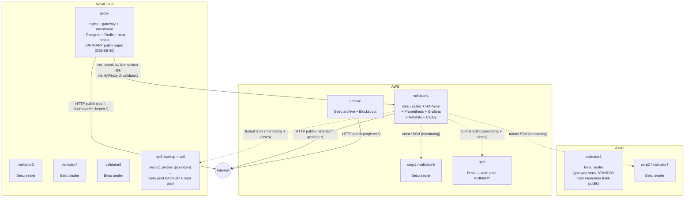
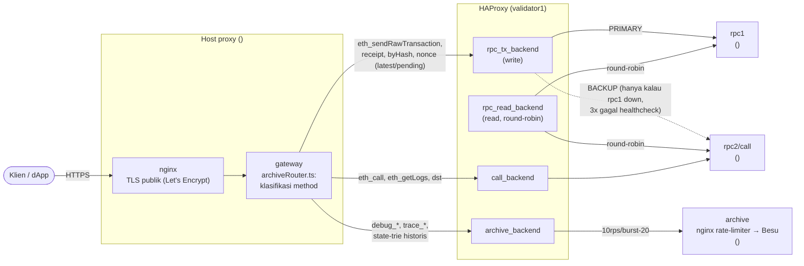
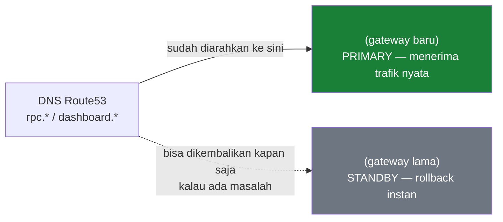

# Diagram Visual — Arsitektur Mainnet

Diagram ini melengkapi [`docs/ARCHITECTURE.md`](../ARCHITECTURE.md) (referensi tertulis
lengkap: spek host, akses SSH, detail konfigurasi) dengan gambaran visual topologi dan
jalur trafik. Dibuat dalam format Mermaid (teks biasa, ter-render otomatis di
GitHub/Azure DevOps, bisa diedit siapa saja tanpa tool khusus). Sinkron dengan kondisi
per **2026-09-30**.

---

## 1. Topologi Host — 3 Cloud Provider

**Catatan kuorum QBFT**: 7 validator (V1, V2, V3, V4, V5, V6, V7) — toleran 2 node mati
bersamaan tanpa network berhenti produksi block. `rpc1`, `rpc2/call`, `archive`, dan
`proxy` BUKAN validator (tidak ikut menandatangani blok).

---

## 2. Jalur Trafik RPC — Write, Read, Archive

**Poin penting** (koreksi dari asumsi lama, diverifikasi live 2026-09-30):
- Write pool (`rpc_tx_backend`) **primary+backup**, BUKAN round-robin — `rpc2` cuma
  aktif kalau `rpc1` gagal healthcheck 3x berturut (~15 detik). Tidak ada skenario
  normal di mana 2 node menerima transaksi tulis bersamaan.
- Hanya `rpc_read_backend` (dipakai untuk `eth_call` dkk, BUKAN untuk kirim transaksi)
  yang genuinely round-robin antara `rpc1` dan `rpc2/call`.
- `rpc2` dan `call` sekarang **1 proses Besu yang sama** (sejak 2026-09-30) —
  container standalone `rpc2` sudah dihapus, perannya diserap node `call`.

---

## 3. Status Migrasi Gateway (2026-09-30)

Data Postgres tersinkron penuh ke host baru (row count exact match tervalidasi).
Sertifikat TLS asli (Let's Encrypt via certbot, `webroot` authenticator). Detail
lengkap: `BACKLOG.md` dan `docs/STATUS_TERDEPLOY_2026-08-20.md` §24-25.

---

*Sumber data: `docs/ARCHITECTURE.md` (2026-09-29, diperbarui 2026-09-30),
`docs/STATUS_TERDEPLOY_2026-08-20.md` §24-25, verifikasi live SSH+RPC 2026-09-30.*
